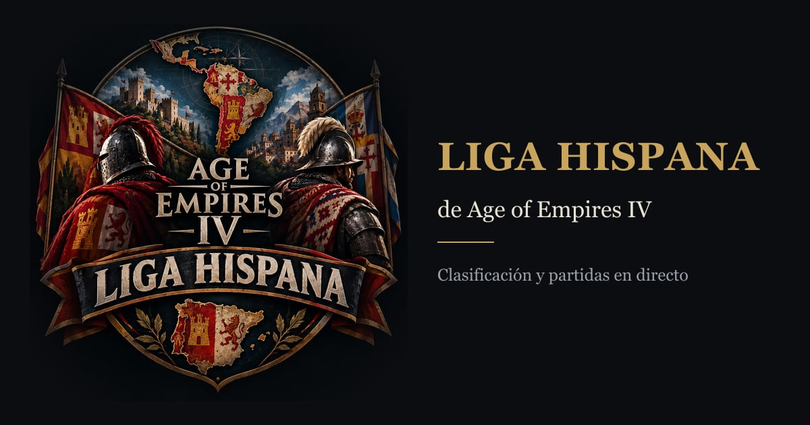
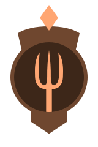
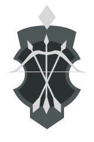
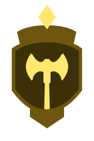
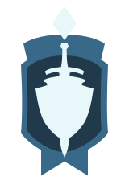
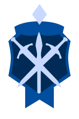
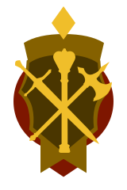

<p align="center">
  
</p>

<h1 align="center">Liga Hispana · Age of Empires IV</h1>

<p align="center">
  Seguimiento del torneo individual de Age of Empires IV: clasificación, partidas en directo,
  objetivos especiales, puntuación, streams de los participantes y reglas.
</p>

<p align="center">
  <a href="https://laligahispana.es"><b>Sitio en vivo</b></a> ·
  <a href="docs/REGLAS.md">Reglas</a> ·
  <a href="docs/PUNTUACION.md">Puntuación</a> ·
  <a href="docs/OBJETIVOS.md">Objetivos</a>
</p>

<p align="center">
  <a href="https://github.com/JavierrMadrid/LigaHispana_AOE4/actions/workflows/ci.yml">
    
  </a>
</p>

---

## Qué es

Un torneo **individual** de Age of Empires IV. No hay equipos: cada persona compite con su propia
cuenta y la clasificación se calcula **sola** a partir de las partidas que publica la API de
[AoE4World](https://aoe4world.com/api), sin que nadie apunte resultados a mano.

La web es el marcador del torneo: se entra a ver quién va primero, qué partidas están en juego ahora
mismo y quién está en directo.

## Qué ofrece la web

| Página | Qué se ve |
|---|---|
| **Clasificación** (`/`) | La tabla del torneo: puesto, jugador, partidas, puntos desglosados en permanentes (los logros, con las victorias dentro porque son el objetivo Victorias) y temporales (competiciones), elo con su rango de liga, V-D y racha; además, quién está en directo y cuánto queda de torneo. Se busca por nombre o canal, se filtra por estado y por varias divisiones a la vez, y pulsar los puntos de un jugador despliega su resumen de objetivos, con enlace a su ficha. Cuando el ruleset activo todavía no se ha recalculado, se muestra la última clasificación calculada y una nota sobre la tabla lo dice. |
| **Partidas** (`/partidas`) | Las partidas que los participantes están jugando en este momento, con el mapa, el tipo de partida y quién está en directo enlazando a su retransmisión de Twitch, YouTube o Kick. Se filtran por tipo de partida, por varias divisiones a la vez y por «en directo» (solo las que se pueden ver), y cuando dos participantes de la misma partida emiten a la vez la tarjeta lleva al visor multi-stream con sus canales. |
| **Objetivos** (`/objetivos`) | Los objetivos activos (hoy 83: 29 competiciones y 54 logros), con sus puntos y quién los cobra. Los de civilización se agrupan por familia (la cabeza y sus subobjetivos, con un filtro de banderas para saltar a cada uno y un riel que se recorre con la rueda, el gesto táctil o dos botones de flecha); las 23 competiciones `Masterizando <civ>` —que no tienen cabeza— van en su propio carrusel, «Masterizando», con el mismo filtro de banderas y riel. La tarjeta de la cabeza explica cómo puntúa el conjunto y cada tarjeta abre una ventana volteable: de primeras se ve la clasificación —solo quien disputa el objetivo—, con su avance (`12/23` civilizaciones, `2/3` victorias o el valor de su métrica en una competición) sobre una barra de fondo que lo compara con el líder de la lista, un check en quien lo ha completado —ninguno en un objetivo sin tope, que lo cobra todo el que suma— y el recuento de completadores sobre el total («3 de 12 lo han completado»); quien todavía no ha empezado la participación no sale en la lista, y su censo está en la clasificación del torneo. Al girarla aparece el resumen de la propia tarjeta, recompuesto en una columna centrada alrededor del emblema del objetivo, que se enseña en grande en un medallón: el arte de la civilización cuando el objetivo es de civilización y el glifo propio de la casa en el resto. Las tarjetas encienden un halo dorado al pasar el ratón y dejan una estela dorada que sigue al cursor por dentro. |
| **Objetivos de un participante** (`/objetivos/<id>`) | El avance de un jugador en los objetivos activos. Los individuales se leen en tres bloques —Al alcance (ordenado de más a menos cerca de cobrarlo), En posesión y Sin disputar— y dentro de "Al alcance", tras sus tarjetas, los de civilización se agrupan en los carruseles de Líder y Acólito, con el mismo riel y filtro de banderas que `/objetivos` pero con el avance del jugador y ordenados de mayor a menor porcentaje de consecución. En «Por tierra y agua», los mapas que le faltan sustituyen al pool entero («Faltan 3 mapas · 2 × Golden Heights, …») y un objetivo repetible lleva sus repeticiones en el rótulo (`2×Imparable`, `24×Victorias`), con lo que ha cobrado de verdad en cada cifra. |
| **Puntuación** (`/puntuacion`) | Cuánto vale cada victoria, qué cuenta como partida clasificatoria, los objetivos especiales y los desempates. Las cifras (puntos por victoria, objetivos activos y su total, premio base) salen del ruleset y de la edición activos. |
| **Reglas** (`/reglas`) | Las normas del torneo: formato, participación, normas de obligado cumplimiento y organización. La retransmisión en directo se lista solo cuando la edición la exige, y la sección de organización anuncia el premio base y las donaciones cuando están publicados. |
| **Participar** (`/participar`) | La inscripción pública al torneo. |

Además, cuando la organización tiene publicada una campaña, todas las páginas públicas muestran arriba
un **banner de donaciones** con el enlace a Matcherino.

La organización tiene además un **panel de administración** para aprobar participantes, revisar
partidas y alertas, gestionar el torneo y publicar la campaña de donaciones. El **superadministrador**
configura además la **edición**: su nombre y su premio base, la marca (emblema y color de acento) que se
aplica a la web pública, si la retransmisión es obligatoria y las reglas de puntuación (ventana,
familias, puntos y objetivos desactivados), todo sin desplegar. También puede **deshacer** lo que
hicieron los admins regulares.

Un **bot de Discord** avisa del comienzo y el final del torneo en el canal de avisos, una sola vez por
aviso, con el nombre de la edición y sus fechas.

## Cómo se compite

- **Individual, en la ladder *ranked*** del juego: 1v1 y ranked por equipos. El resto de modos no
  puntúa.
- **Los puntos del ruleset activo**: por defecto **2 por victoria**, que se cobran como el objetivo
  **Victorias**, más los demás **objetivos activos** (hoy 83) que reparten puntos extra:
  **competiciones** (los cobra quien va primero) y **logros** (los cobra quien cumple la condición).
- **Ventana de fechas**: solo cuentan las partidas jugadas dentro del periodo del torneo.
- **Equipos equilibrados**: una partida por equipos solo cuenta si ningún compañero está a dos
  escalones o más de división del jugador, por encima o por debajo.
- **Transparencia**: la organización vigila comportamientos que podrían inflar la clasificación
  (abandonar para bajar de elo, rivales repetidos…) y avisa para revisarlos.
- **Directos**: se detecta si un participante está transmitiendo en Twitch, YouTube o Kick.

Todo el detalle está en [`docs/REGLAS.md`](docs/REGLAS.md), [`docs/PUNTUACION.md`](docs/PUNTUACION.md)
y [`docs/OBJETIVOS.md`](docs/OBJETIVOS.md).

<p align="center">
  
  
  
  
  
  
</p>

---

## Especificaciones técnicas

Resumen de con qué está hecho. El detalle vive en [`docs/`](docs).

### Stack

| Capa | Elección |
|---|---|
| Framework | Next.js 16 (App Router) + TypeScript |
| Estilos | TailwindCSS v4, tokens en `src/app/globals.css` |
| Datos | PostgreSQL en Supabase + Prisma 7 (`prisma/schema.prisma`) |
| Auth | Supabase Auth, solo para el panel de administración |
| Datos externos | API de AoE4World; YouTube y Kick para los directos |
| Despliegue | Cloudflare Workers con OpenNext |

### Cómo funciona

```
Supabase Cron ──► Worker (Cloudflare) ──► API de AoE4World
                       │
                       ├──► YouTube / Kick (directos)
                       ▼
                  PostgreSQL (Supabase)
                       │
                       ▼
   Web: clasificación · partidas · objetivos · puntuación · reglas
                       ▲
                       └── Panel /admin (solo organización)
```

- El **reloj** es un job de `pg_cron` en la base de datos que dispara la sincronización cada 10 minutos;
  un workflow de GitHub queda como red de seguridad.
- El **motor de puntuación** lee las partidas guardadas, aplica el ruleset activo y escribe la
  clasificación. Se recalcula solo.
- Las **reglas y los puntos** son configurables sin desplegar (viven en la tabla `Setting`).

### Acceso al panel

El panel de administración (`/admin`) es solo para la organización, y tiene **dos papeles**:

- **Superadministrador**: la cuenta cuyo correo está en `SUPERADMIN_EMAIL`. Es única y puede, además
  de todo lo de un admin, invitar a otros admins, darlos de baja y reactivarlos, **deshacer** lo que
  hicieron los admins regulares desde el historial de `/admin/acciones` y mandar un aviso de prueba al
  canal de Discord del torneo.
- **Admin**: cualquier cuenta de la tabla `Admin` que esté **activa**. No puede tocar la lista de
  admins.

Lo del superadministrador vive en la pestaña **Administración**, que solo él ve y que se organiza en
subpestañas: **Administradores** (invitar, dar de baja y reactivar), **Edición**, **Puntuación**,
**Inscripciones** (el plazo y los países admitidos), **Donaciones** y **Avisos** (la prueba del canal
de Discord). El resto del panel es igual para los dos papeles.

El alta es **por invitación**: se escribe el correo en el panel y la persona recibe un enlace para
fijar su contraseña (pasa por `/auth/confirm` y termina en `/login/establecer-contrasena`); un enlace
caducado o ya usado lleva a `/login?error=enlace`, que lo explica. Dar de baja **desactiva** la
cuenta —no la borra—, así que se puede reactivar. Quien entra con una cuenta sin acceso ve
`/sin-acceso`. El detalle operativo está en
[`docs/OPERACION.md`](docs/OPERACION.md#administración-del-panel).

### Puesta en marcha

Requiere Node.js 20+ y una base de datos PostgreSQL.

```bash
npm install          # dependencias + cliente Prisma
cp .env.example .env # rellena DATABASE_URL
npm run db:push      # crea las tablas
npm run dev          # http://localhost:3000
```

### Comandos

| Comando | Qué hace |
|---|---|
| `npm run dev` | Servidor de desarrollo. |
| `npm run build` / `npm run start` | Build y arranque de producción. |
| `npm run lint` / `npm test` | ESLint y tests (Vitest). |
| `npm run sync` | Sincroniza partidas de AoE4World. |
| `npm run score` | Recalcula la clasificación. |
| `npm run db:push` / `npm run db:security` | Sincroniza el schema y aplica la postura de RLS. |
| `npm run db:cron` | Programa el reloj del torneo (Supabase Cron). |
| `npm run mock:tournament` | Simula el torneo con fixtures locales. |
| `npm run deploy` / `npm run preview` | Despliega el Worker (producción / local). |

### Despliegue

**Producción despliega sola**: el repositorio está conectado a Cloudflare Workers Builds. Un push a
`main` publica en `https://laligahispana.es`; un push a cualquier otra rama genera un **Preview** con
su propia URL. GitHub Actions comprueba lint, build y tests en cada pull request.

### Documentación

| Documento | Contenido |
|---|---|
| [`docs/REGLAS.md`](docs/REGLAS.md) | Normas para participar y reglas internas del torneo. |
| [`docs/PUNTUACION.md`](docs/PUNTUACION.md) | El sistema de puntuación: qué cuenta y cuánto vale. |
| [`docs/OBJETIVOS.md`](docs/OBJETIVOS.md) | Los 83 objetivos, con sus puntos. |
| [`docs/MODELO-DATOS.md`](docs/MODELO-DATOS.md) | El esquema de la base de datos, tabla por tabla. |
| [`docs/DESPLIEGUE.md`](docs/DESPLIEGUE.md) | Producción y previews, variables, Hyperdrive y problemas conocidos. |
| [`docs/OPERACION.md`](docs/OPERACION.md) | Sincronización, alertas, simulaciones y operativa diaria. |

### Desarrollo con agentes

El trabajo se reparte entre dos subagentes, cada uno con su guía en `.opencode/agent/`:
`@design-ux` (interfaz y copy) y `@logic-data` (lógica, datos, auth y API). Las reglas de enrutado y
las convenciones del repositorio están en [`AGENTS.md`](AGENTS.md).

---

<p align="center">
  
</p>
